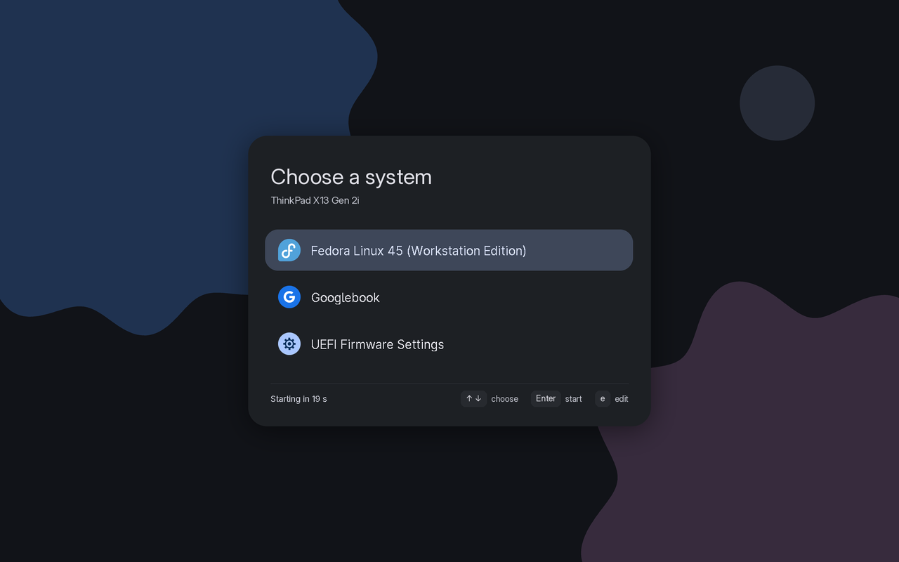

# material3-grub

A Material 3 theme for GRUB, with a generator script and an installer.



The theme is dark, uses a blue seed colour, and has M3 Expressive shapes in the background. It is built for a 1920x1200 panel.

## Contents

- `tools/grub/material3/`: the built theme (`theme.txt`, background, icons, menu fonts)
- `tools/grub/make_theme.py`: regenerates the theme from the colours and layout constants at the top of the file
- `tools/grub/install_grub.sh`: installs the theme and enables the graphical menu (dry run by default)
- `tools/grub/logos/`: source SVGs for the Fedora icon
- `docs/img/grub.png`: screenshot
- `docs/grub.md`: design notes, installer steps, and how to undo them

## Icons

Each menu entry shows the icon for its `--class` names. GRUB tries the classes in order and uses the first matching file in `material3/icons/`:

| File | Used for |
|---|---|
| `fedora.png` | entries with `--class fedora` (Fedora's own entries) |
| `efi.png` | the UEFI firmware settings entry (`--class efi`) |
| `os.png` | fallback: a neutral disc. `grub-mkconfig` gives every generated entry `--class os`, so any OS without its own icon gets this one |

To add an icon for another OS, add `material3/icons/<class>.png` at 48x48 and copy the theme (see below). Check the class name in your generated `grub.cfg`. A file named after a class that is only in your own `menuentry` also works.

## Requirements

- Pillow (`python3-pillow`)
- `grub2-mkfont` and `rsvg-convert` (`librsvg2-tools`)
- Google Sans Flex Regular (`GoogleSansFlex-Regular.ttf`) at `/usr/share/fonts/google-sans-flex/`, or set `GRUB_THEME_FONT` to its path (SIL OFL)
- DejaVu Sans (`fonts-dejavu-core`) for the ↑ ↓ arrows, which Google Sans Flex does not have
- Fedora's `grub2-tools` (the installer uses `grub2-mkconfig` and `grub2-editenv`)

## Install

Dry run first. It prints every command and changes nothing:

```bash
sh tools/grub/install_grub.sh
```

Then run it with `--run`. It asks before each step:

```bash
sudo sh tools/grub/install_grub.sh --run
```

The installer copies the theme to `/boot/grub2/themes/material3`, sets `GRUB_TERMINAL_OUTPUT`, `GRUB_GFXMODE` and `GRUB_THEME` in `/etc/default/grub`, shows the menu on every boot, and regenerates `grub.cfg`. The original `/etc/default/grub` is kept as `/etc/default/grub.before-material3`.

## Rebuild the theme

```bash
python3 tools/grub/make_theme.py          # asks for the device name, then writes tools/grub/material3/
sudo cp -r tools/grub/material3 /boot/grub2/themes/material3
```

Copying the files is enough. Run `grub2-mkconfig` again only if the font names change.

## Undo

```bash
sudo cp -p /etc/default/grub.before-material3 /etc/default/grub
sudo rm -r /boot/grub2/themes/material3
sudo grub2-editenv - set menu_auto_hide=1
sudo grub2-mkconfig -o /boot/grub2/grub.cfg
```

## Notes

- The device name under "Choose a system" is asked for when `make_theme.py` runs in a terminal (Enter keeps "ThinkPad X13 Gen 2i"). Set `GRUB_THEME_DEVICE` to skip the prompt, for example `GRUB_THEME_DEVICE="My Laptop" python3 tools/grub/make_theme.py`.
- The Fedora icon is Fedora's logo, a trademark of its owner, used only as a menu icon.
